# Command Vault

**A lightweight launcher for your own scripts, tools, and apps** — no more `cd`-ing into folders and running `./script.sh` by hand.


Save any command, script, or AppImage once, organize it by category, and launch it with one click — in a terminal or silently in the background.

<p align="center">
  
  
</p>

## Features

- **One-click launching** for shell commands, multi-line scripts, `.sh` / `.bat` / `.ps1` / `.py` files, and AppImages
- **Categories** to organize tools (e.g. AI Tools, Dev Environments, Media)
- **Custom icons** per entry, picked from a built-in emoji grid
- **Working directory** support — no need to bake `cd` into your commands
- **Terminal or silent mode** — open a terminal window, or run detached in the background
- **Autostart** — launch Command Vault itself at login, and/or set individual entries to start automatically on boot (works independently of whether Command Vault is running)
- **Pick Installed App** — browse your system's installed applications directly (`.desktop` files on Linux, Start Menu shortcuts on Windows) instead of hunting for paths
- **Configurable data storage** — commands are stored in an organized, OS-appropriate folder by default (`~/.local/share/command-vault` on Linux, `%APPDATA%\CommandVault` on Windows), and you can change the location from Settings

## Downloads

Prebuilt binaries are attached to each [release](../../releases):

| Platform | File |
|---|---|
| Linux | `CommandVault-x86_64.AppImage` — make it executable (`chmod +x`) and run it |
| Windows | `CommandVault.exe` |

## Running from source

Requires Python 3.9+ with Tk support (`python3-tk` on Debian/Ubuntu-based systems; bundled with the standard installer on Windows).

```bash
python3 main.py
```

## Building it yourself

Builds are automated via GitHub Actions (see [`.github/workflows/build.yml`](.github/workflows/build.yml)), which produces both the Linux AppImage and Windows exe on every tagged release (`vX.Y.Z`) or manual workflow run.

**Linux:**
```bash
pip install pyinstaller
pyinstaller --onefile --windowed --name CommandVault --icon packaging/icon.ico main.py
# then wrap dist/CommandVault into an AppImage using appimagetool + packaging/command-vault.desktop
```

**Windows:**
```powershell
pip install pyinstaller
pyinstaller --onefile --windowed --name CommandVault --icon packaging/icon.ico main.py
```

## Architecture

How the pieces of Command Vault fit together (`main.py` is just the entry point; everything else lives in the `cmdvault/` package).

```mermaid
%% Generated by https://gitdiagram.com/somore100/comand-launcher
flowchart TD

subgraph group_workspace["Desktop workspace"]
  node_main["Application entry<br/>[main.py]"]
  node_app["Vault window<br/>[app.py]"]
  node_settings["Settings<br/>[settings_dialog.py]"]
end

subgraph group_entry["Entry authoring"]
  node_entrydialog["Entry editor<br/>[entry_dialog.py]"]
  node_routinedialog["Routine editor<br/>[routine_dialog.py]"]
  node_bulk["Bulk import/export<br/>[bulk.py]"]
  node_apps["Installed apps<br/>[apps.py]"]
end

subgraph group_runtime["Command runtime"]
  node_execution["Command execution<br/>[execution.py]"]
  node_privilege["Admin permissions<br/>[privilege.py]"]
  node_terminals["Terminal launch<br/>[terminals.py]"]
  node_placeholders["Input placeholders<br/>[placeholders.py]"]
  node_browser["Browser profiles<br/>[browser.py]"]
end

subgraph group_automation["Automation"]
  node_routine["Web routines<br/>[routine.py]"]
  node_scheduler["Scheduled runs<br/>[scheduling.py]"]
  node_autostart["Startup runs<br/>[autostart.py]"]
end

subgraph group_support["Platform and support"]
  node_store[("Command data<br/>[data.py]")]
  node_config["App configuration<br/>[config.py]"]
  node_hotkeys["Global shortcuts<br/>[hotkeys.py]"]
  node_runstatus["Run status log<br/>[runstatus.py]"]
  node_feedback["Feedback relay<br/>[feedback.py]"]
end

node_user(("User"))
node_os{{"Operating system"}}

node_user -->|"starts app"| node_main
node_main -->|"opens window"| node_app
node_app -->|"loads commands"| node_store
node_app -->|"edits entries"| node_entrydialog
node_app -->|"runs entry"| node_execution
node_app -->|"opens settings"| node_settings
node_app -->|"configures shortcuts"| node_hotkeys
node_entrydialog -->|"edits entry data"| node_store
node_entrydialog -->|"browses installed apps"| node_apps
node_entrydialog -->|"edits routine steps"| node_routinedialog
node_app -->|"imports or exports"| node_bulk
node_bulk -->|"reads and writes"| node_store
node_app -->|"manages schedules"| node_scheduler
node_app -->|"manages startup"| node_autostart
node_settings -->|"reads settings"| node_config
node_settings -->|"submits feedback"| node_feedback
node_settings -->|"records shortcuts"| node_hotkeys
node_execution -->|"applies permissions"| node_privilege
node_execution -->|"sets profile environment"| node_browser
node_execution -->|"launches in terminal"| node_terminals
node_execution -->|"resolves inputs"| node_placeholders
node_routine -->|"drives browser or desktop"| node_os
node_scheduler -->|"runs scheduled entry"| node_execution
node_autostart -->|"prepares entry command"| node_execution
node_app -->|"shows run history"| node_runstatus
node_app -->|"launches commands"| node_os
node_autostart -->|"registers startup"| node_os

classDef toneBlue fill:#dbeafe,stroke:#2563eb,stroke-width:1.5px,color:#172554
classDef toneAmber fill:#fef3c7,stroke:#d97706,stroke-width:1.5px,color:#78350f
classDef toneMint fill:#dcfce7,stroke:#16a34a,stroke-width:1.5px,color:#14532d
classDef toneRose fill:#ffe4e6,stroke:#e11d48,stroke-width:1.5px,color:#881337
classDef toneIndigo fill:#e0e7ff,stroke:#4f46e5,stroke-width:1.5px,color:#312e81
class node_main,node_app,node_settings,node_user toneBlue
class node_entrydialog,node_routinedialog,node_bulk,node_apps toneAmber
class node_execution,node_privilege,node_terminals,node_placeholders,node_browser toneMint
class node_routine,node_scheduler,node_autostart toneRose
class node_store,node_config,node_hotkeys,node_runstatus,node_feedback,node_os toneIndigo
```



<sub>Diagram generated on 2026-11-05 with [GitDiagram](https://gitdiagram.com/somore100/comand-launcher) from this repository's source. It is a snapshot: newer helper modules such as `scrollframe.py`, `feedback_dialog.py`, `automation_help_dialog.py` and `cvauto_source.py` (the automation helper library) are not drawn yet.</sub>

## Contributing

Issues and pull requests are welcome — especially around packaging for additional platforms (e.g. a macOS build) or new launch modes.

## License

MIT — see [LICENSE](LICENSE).
